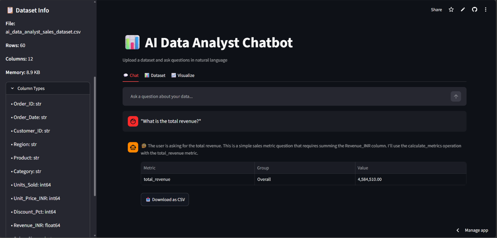
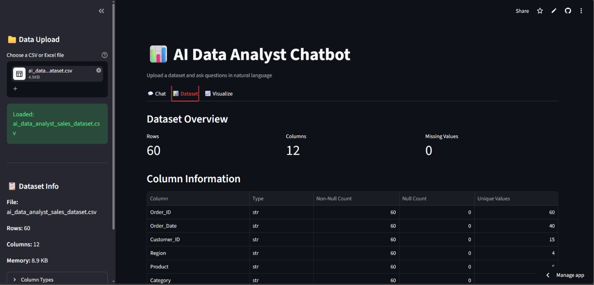
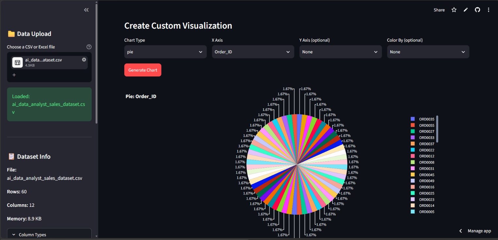

# AI Data Analyst Chatbot

A Streamlit-based AI data analyst that lets you upload CSV/Excel files and ask questions in natural language. Powered by NVIDIA Nemotron 3 Ultra via OpenAI-compatible API.

## Features

- **Data Upload**: Support for CSV and Excel (.xlsx, .xls) files with validation and error handling
- **Dataset Profiling**: View rows, columns, data types, missing values, duplicates, numerical summaries, categorical summaries
- **AI-Powered Analysis**: Ask questions in natural language, get computed answers via structured JSON operations
- **Sales Metrics Calculation**: Exact totals, averages, counts, median, std using Pandas with optional grouping
- **Time Series Analysis**: Monthly, quarterly, yearly aggregation with date-range filtering and month-over-month change
- **Data Quality Reports**: Comprehensive data quality analysis including null analysis, duplicate detection, date column detection, issue identification
- **Interactive Visualizations**: Bar, line, scatter, histogram, box, violin, pie charts with automatic chart selection
- **Export Functionality**: Download results as CSV, data quality reports as JSON
- **Secure**: API key from environment variable, no arbitrary code execution, validated operations
- **Clean UI**: Professional Streamlit dashboard with sidebar, chat interface, and tabbed views

## Quick Start

### 1. Clone and Install

```bash
git clone <your-repo>
cd ai-data-analyst

# Create virtual environment (recommended)
python -m venv venv
source venv/bin/activate  # On Windows: venv\Scripts\activate

# Install dependencies
pip install -r requirements.txt
```

### 2. Configure API Key

Copy the example environment file and add your NVIDIA API key:

```bash
cp .env.example .env
```

Edit `.env` and add your API key:

```env
NVIDIA_API_KEY=your_actual_api_key_here
```

Get your API key from: https://integrate.api.nvidia.com

### 3. Run the App

```bash
streamlit run app.py
```

The app will open at `http://localhost:8501`

## Usage

### Upload Data
1. Open the sidebar (☰)
2. Click "Browse files" and select a CSV or Excel file
3. Dataset info appears in sidebar

### Ask Questions
Go to the **Chat** tab and ask questions like:
- "What is the total revenue and total units sold?"
- "Show me average order revenue and number of orders"
- "Calculate sales metrics by region"
- "What is the median and standard deviation of revenue?"
- "Calculate total revenue for each month"
- "Show monthly revenue in a line chart"
- "Which month had the highest revenue?"
- "Show monthly units sold"
- "Compare monthly revenue across months"
- "Show quarterly revenue trends"
- "Show yearly revenue with month-over-month change"
- "Filter data for January to March 2026"
- "Generate a data quality report"
- "Are there any missing values in the dataset?"
- "Create a bar chart of sales by region"
- "Group by category and show mean price"

### View Dataset Details
Click the **Dataset** tab for:
- Row/column counts
- Column types and null counts
- First 5 rows preview
- Duplicate row detection

### Create Custom Charts
Click the **Visualize** tab to build custom Plotly charts:
- Select chart type (bar, line, scatter, histogram, box, violin, pie)
- Choose X axis, Y axis (optional), and color grouping
- Click "Generate Chart"

## Supported Operations

The AI can perform these operations on your data:
- `describe` - Statistical summary
- `groupby` - Group and aggregate
- `filter` - Filter rows (eq, ne, gt, lt, ge, le, isin, between)
- `sort` - Sort values
- `aggregate` - Aggregate functions
- `calculate_metrics` - **Calculate exact sales metrics** (total_revenue, total_units, avg_order_revenue, num_orders, median_revenue, std_revenue, min_revenue, max_revenue) with optional grouping
- `time_series_aggregation` - **Time series analysis** (monthly, quarterly, yearly) with date-range filtering, period-over-period change, multiple aggregation functions
- `data_quality_report` - **Comprehensive data quality analysis** (null analysis, duplicates, date detection, issues, statistics)
- `value_counts` - Count unique values
- `unique` - Get unique values
- `nunique` - Count unique values per column
- `corr` / `cov` - Correlation/covariance matrix
- `head` / `tail` / `sample` - View rows
- `shape` - Dataset dimensions
- `dtypes` - Column data types
- `isnull_sum` - Missing value counts
- `duplicates_sum` - Duplicate row count

## Security

- **No hardcoded API keys**: Reads from `NVIDIA_API_KEY` environment variable
- **No code execution**: Only predefined pandas operations are allowed
- **Column validation**: All column references validated against actual dataset
- **Operation allowlist**: Only whitelisted operations can be executed

## Configuration

Environment variables (in `.env`):

| Variable | Default | Description |
|----------|---------|-------------|
| `NVIDIA_API_KEY` | *required* | Your NVIDIA API key |
| `NVIDIA_BASE_URL` | `https://integrate.api.nvidia.com/v1` | API base URL |
| `NVIDIA_MODEL` | `nvidia/nemotron-3-ultra-550b-a55b` | Model name |

## Project Structure

```
ai-data-analyst/
├── app.py              # Main Streamlit application
├── test_analyst.py     # Comprehensive unit tests
├── requirements.txt    # Python dependencies
├── .env.example        # Environment variable template
├── .gitignore          # Git ignore rules
└── README.md           # This file
```

## Requirements

- Python 3.9+
- NVIDIA API key (free tier available)

## Troubleshooting

**"NVIDIA API key not configured"**
- Ensure `.env` file exists with `NVIDIA_API_KEY=your_key`
- Restart the app after adding the key

**"Failed to load file"**
- Check file is valid CSV/Excel
- Ensure file isn't corrupted or password-protected

**Chart not generating**
- Verify X axis column exists
- For bar/line: X should be categorical, Y numeric
- For scatter: Both X and Y should be numeric

## License

MIT License
## 📸 Application Screenshots

### Home Page


### Data Overview


### Data Visualization

## 🚀 Live Demo

**Try the AI Data Analyst Chatbot online:**

[Launch the Application](https://ai-data-analyst-vbxursw8daupwmytt9ddz6.streamlit.app/)

